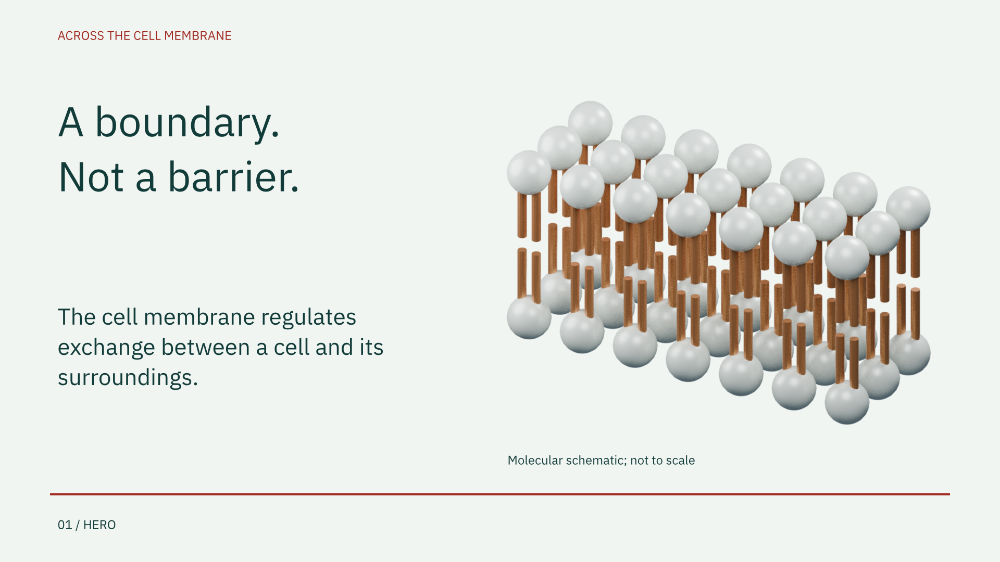
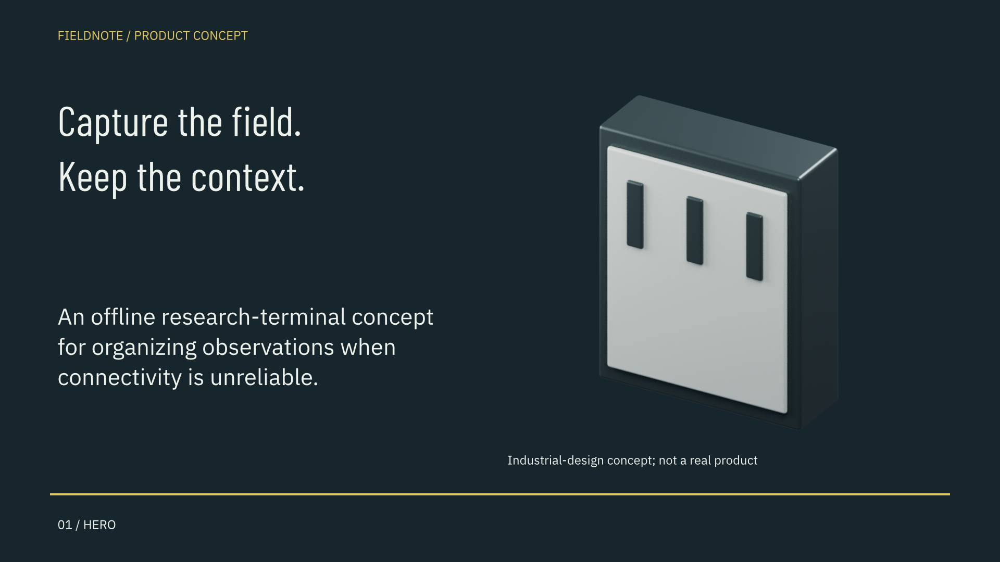
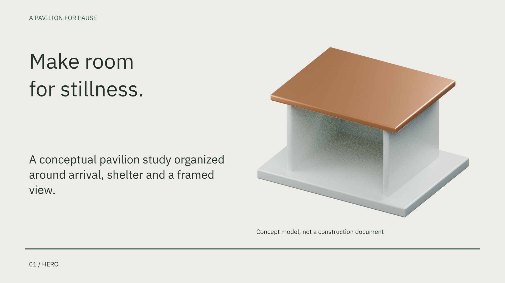
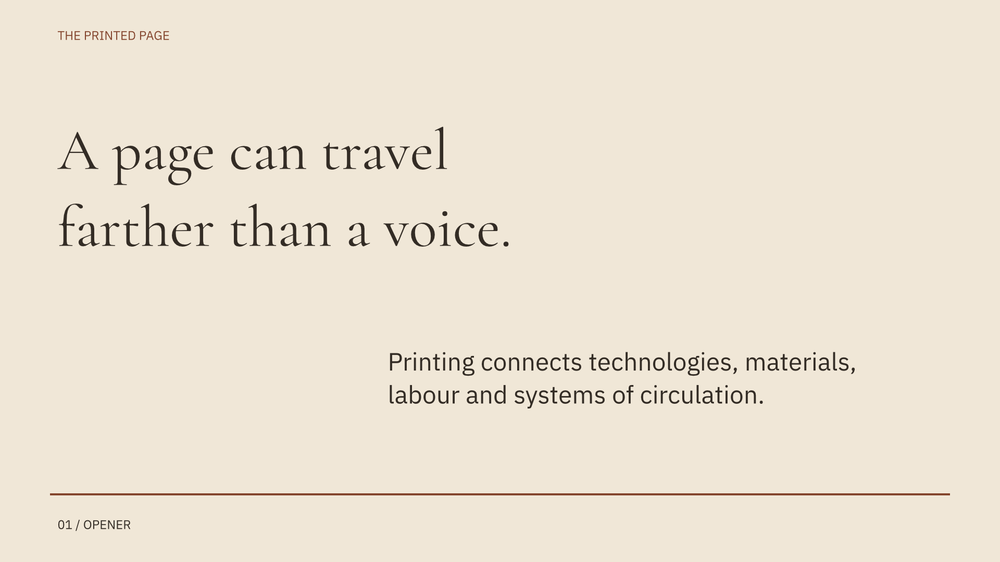
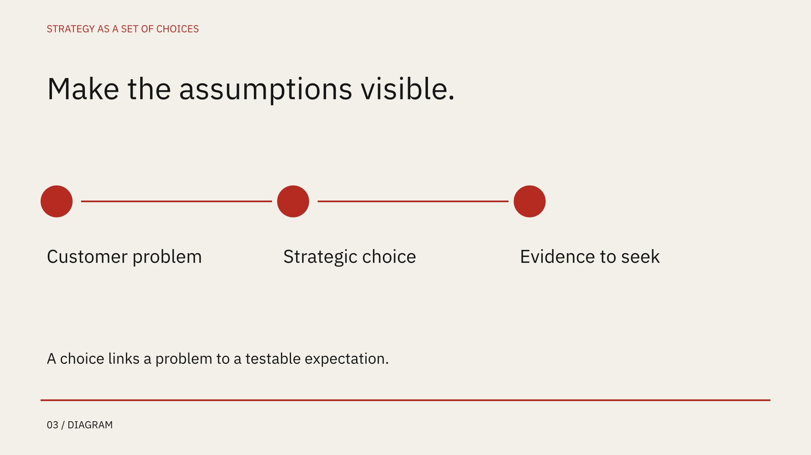

# Five production fixtures

25 slides generated with the real DeckCraft CLI, native editable text/shapes, speaker notes and PDF export. Each slide was rendered at 1920×1080 from its exported PPTX and inspected. Three decks use real CPU-Blender geometry.

**These are engineering/design review drafts, not Office-certified client deliverables.** Automated QA passes; the release gate correctly remains blocked on Office compatibility and outstanding professional breadth. Each folder contains the source brief, command script, composition, QA report, hash-bound visual observations and full-resolution slides.

| Subject | PowerPoint | PDF | Overview |
|---|---|---|---|
| Scientific education | [PPTX](science/deck.pptx) | [PDF](science/deck.pdf) | [Contact sheet](science/contact.png) |
| Business strategy | [PPTX](strategy/deck.pptx) | [PDF](strategy/deck.pdf) | [Contact sheet](strategy/contact.png) |
| Technology concept | [PPTX](product/deck.pptx) | [PDF](product/deck.pdf) | [Contact sheet](product/contact.png) |
| Architecture concept | [PPTX](architecture/deck.pptx) | [PDF](architecture/deck.pdf) | [Contact sheet](architecture/contact.png) |
| Historical education | [PPTX](history/deck.pptx) | [PDF](history/deck.pdf) | [Contact sheet](history/contact.png) |

## Scientific education — membrane schematic

## Product concept — real rendered enclosure

## Architecture — real rendered pavilion

## Historical / museum typography

## Business strategy

